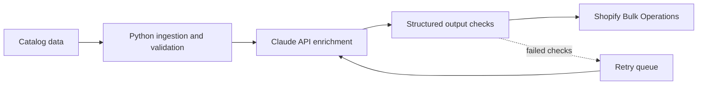

# Muhammad Kamran

### Full-Stack & AI Engineer · CEO of Xevenlabs

&nbsp;

## 👋 About

I design and build **production-grade ecommerce platforms, SaaS products and AI-powered features** for founders and growing businesses. I lead **Xevenlabs**, a full-stack and AI development agency, and stay hands-on in architecture, code review and delivery on every project.

> Most of my client work is under NDA, so the code lives in private repositories. The live products below are the proof.

&nbsp;

## 🧭 What I build

<table>
<tr>
<td width="50%" valign="top">

### 🛒 Ecommerce
Shopify custom themes and apps, platform migrations (WooCommerce, BigCommerce, Squarespace to Shopify), CRO and API integrations.

</td>
<td width="50%" valign="top">

### ⚙️ SaaS & Web Apps
Next.js, React and Node products on Supabase / PostgreSQL with Stripe, auth, dashboards and role-based access.

</td>
</tr>
<tr>
<td width="50%" valign="top">

### 🤖 AI Integrations
Claude API features, RAG pipelines, streaming responses, chatbots and large-scale data enrichment.

</td>
<td width="50%" valign="top">

### 🧩 WordPress & LMS
WooCommerce, Tutor LMS, custom plugins and third-party API integrations with a performance focus.

</td>
</tr>
</table>

&nbsp;

## 🛠️ Tech stack

| Area | Technologies |
|---|---|
| **Frontend** |      |
| **Backend** |      |
| **Data** |    |
| **Ecommerce & CMS** |     |
| **AI** |    |
| **Cloud & Tools** |     |

&nbsp;

## 🚀 Selected work

| Project | What was built | Stack |
|---|---|---|
| **[CREUW.AI](https://creuw-ai.vercel.app)** | Commercial real-estate SaaS with AI analysis | Next.js · Supabase · Claude API |
| **Mega Office Supplies** | AI product-enrichment pipeline across 28,000 products, plus a B2B customer portal built to OWASP ASVS Level 2 | Python · Claude API · Shopify Bulk Ops · Next.js · Cin7 · Xero |
| **[The Cognitive Blueprint](https://thecognitiveblueprint.com)** | Multi-phase enterprise platform build | Full-stack web |
| **[Opening Paths](https://openingpaths.com)** | Online course platform with memberships and payments | WordPress · Tutor LMS Pro · WooCommerce |
| **[CB Machining](https://cb-machining.com)** | Custom Shopify app with live shipping rates | Shopify · Laravel · Freightcom API |
| **[Bare Naked Botanicals](https://barenakedbotanicals.com)** | Full store migration, zero catalog loss | BigCommerce to Shopify |

&nbsp;

## 🏗️ Example: AI enrichment pipeline

How I structure an AI feature so it stays reliable at scale (pattern from the Mega Office Supplies build):

&nbsp;

## 🤝 How I work

| Principle | What it means for you |
|---|---|
| **Scope first** | Clear requirements and fixed milestones before any code is written |
| **Transparent delivery** | Regular updates and a working demo at every milestone |
| **Engineering depth** | A team of 10 developers at Xevenlabs, with a senior core of 5+ years experience each |
| **Clean handover** | Documented, maintainable code that your team can own |

&nbsp;

## 📬 Let's work together

Have a Shopify, web app or AI project? Send me the problem and I'll tell you honestly how I'd solve it, how long it takes and what it costs.

Xevenlabs · From idea to product

